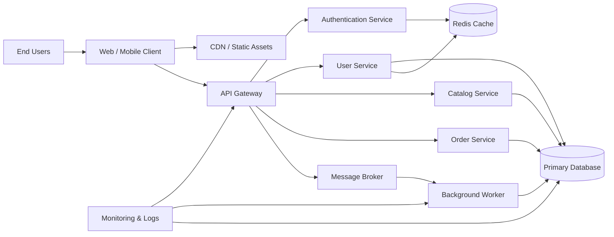

# Architecture Overview

This diagram provides a high-level view of the system architecture and the primary interaction flow between clients, application services, and supporting infrastructure.

## Overview

- Clients connect through a single API entry point.
- Core business services are separated by responsibility: authentication, users, catalog, and orders.
- A shared primary database stores transactional data.
- Redis provides fast access for session and caching needs.
- A message broker decouples asynchronous processing from the request path.
- Monitoring infrastructure observes traffic, background tasks, and data layer health.
